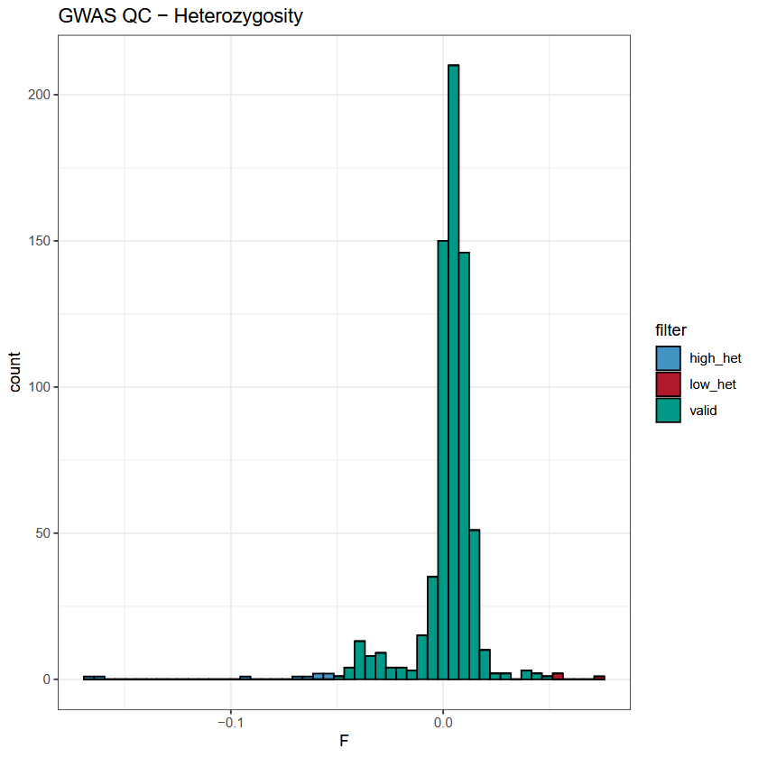
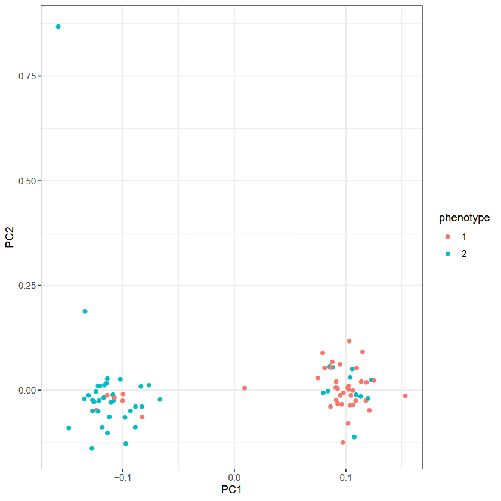

# Quality Control

In this pratical the quality control steps will be shared between the common (GWAS) and rare (RVAS) variants association studies. The main steps are:

 1. [Remove variants and individuals based on missing data](#missing-data)
 2. [Remove variants based on Hardy-Weinberg](#hardy-weinberg)
 3. [Remove individuals with extreme heterozygosity](#heterozygosity)
 4. [Remove related individuals](#kinship)
 5. [Compute the PCA](#principal-components-analysis)
 6. [Remove Rare SNPs](#minor-allele-frequencies)

## The data:

The data for this practical is available under [./data/](../data/) and contains:
 - *gwas.{bim,bed,fam}*: genotyping data in the [plink](https://www.cog-genomics.org/plink/1.9/) format
 - *gwas.covars*: a file of covariates
 - *regions.bed*: a file listing the genomic regions to analyse

### The plink format:

To perform a GWAS we need the phenotype of each individual and their genotype at each marker, usually Single Nucleotide Polymorphisms (SNPs). To perform the quality control steps, we will use the [PLINK](https://www.cog-genomics.org/plink/1.9/) software, which read the required information from coupled .bim / .bed and .fam files:

 - The [.bim](https://www.cog-genomics.org/plink/1.9/formats#bim) file lists all the genotyped variants (position and alleles):
  
    | chromosome | identifier | position\_morgans | position\_bp | allele\_1 | allele\_2 |
    | --- | --- | --- | --- | --- | --- |
    | 1 | rs7519837 | 0 | 1596068 | C | T |
    | 1 | rs3737628 | 0 | 1755094 | T | C |
    | 1 | rs7511905 | 0 | 1825948 | A | C |
    | 1 | rs3855951 | 0 | 1836464 | C | T |
    | 1 | rs6603803 | 0 | 1844850 | G | A |

> [!NOTE]  
> The actual file does **not** have a header file.

 - The [.fam](https://www.cog-genomics.org/plink/1.9/formats#fam) file contains sample information:

    | FID | IID | paternal\_ID | maternal\_ID | sex | phenotype |
    | --- | --- | --- | --- | --- | --- |
    | CH18524 | NA18524 | 0 | 0 | 1 | 1 |
    | CH18526 | NA18526 | 0 | 0 | 2 | 1 |
    | CH18529 | NA18529 | 0 | 0 | 2 | 1 |
    | CH18532 | NA18532 | 0 | 0 | 2 | 1 |
    | CH18537 | NA18537 | 0 | 0 | 2 | 2 |

 - The [.bed](https://www.cog-genomics.org/plink/1.9/formats#bed) file represents the genotype calls in binary format. Each genotype is encoded using 2 bits per individual per SNP, with the following conventions:

    | Code | Meaning |
    | --- | --- |
    | 00 | Homozygous for the first allele (e.g., AA) |
    | 01 | Heterozygous (e.g., AB) |
    | 10 | Missing genotype |
    | 11 | Homozygous for the second allele (e.g., BB) |

The alleles are ordered according to the [.bim](https://www.cog-genomics.org/plink/1.9/formats#bim) file, where the first allele is the reference allele and the second is the alternate allele. The individuals are ordered as specified in the [.fam](https://www.cog-genomics.org/plink/1.9/formats#fam) file.

> [!NOTE]
> More information about the formats can be found in the [PLINK documentation](https://www.cog-genomics.org/plink/1.9/formats).

**Questions**: 

**Q1.1:** Have a look in chr15.bim. At which genomic position is located SNP rs4932079? What are the two observed alleles for this SNP is this dataset?

<details>
    <summary> Answer </summary> 

> rs7111951 is located on chr11 at position 19973135 and the two observed alleles are *G* and *A*.

</details>

**Q1.2:** Have a look in gwas.fam. Which gender is individual NA18550?

<details>
    <summary> Answer </summary> 
    
> NA18547 is a female (5th column = 2).

</details>

## Our first steps with plink:

PLINK is a command-line standalone software dedicated to GWAS analyses. You will call this software with the alias `plink`. Try to print the help menu with the following command-line:

```shell
plink --help
```

For each of its function, PLINK will print a summary of data and actions in the console. We can get information about missing data in our files using the [--missing](https://www.cog-genomics.org/plink/1.9/basic_stats#missing) option. Do not forget to indicate your input dataset using `--bfile` and an output name with `--out`:

```shell
plink --bfile gwas --missing --out gwas_missing
```

**Q1.3:** How many individuals contains this dataset ? How many males/females? How many variants?

<details>
    <summary> Answer </summary> 
    
> The dataset contains 90 people (45 males, 45 females) and 261,191 variants. 

</details>

## Missing data

The robustness of any result obtained with a GWAS depends heavily on the quality of the input data. This is why it is necessary to assess and filter the input data before doing any association tests. Usually variants and individuals with >5% missing data are removed from the dataset. This threshold can be adapted to your dataset (higher to keep more data, lower to be stricter). In PLINK, this can be done using the [--geno](https://www.cog-genomics.org/plink/1.9/filter#missing) and [--mind](https://www.cog-genomics.org/plink/1.9/filter#missing) options to filter variants and individuals respectively. For example to remove variants with >5% missing data, we can write:

```shell
plink --bfile gwas --geno 0.05 --make-bed --out gwas_filtered
```

The output dataset will be called `gwas_filtered` and will be in the plink format (.bim/.bed/.fam).

**Q1.4:** Write the command to filter invididuals with more than 5% missing data (do not forget to start from the SNP-filtered dataset).

<details>
    <summary> Answer </summary> 

```shell
plink --bfile gwas_filtered --mind 0.05 --make-bed --out gwas_filtered
```

</details>

 **Q1.5:** How many individuals and variants are left after filtering?

<details>
    <summary> Answer </summary> 

> 258,125 variants and 89 people are left.

</details>

Missing data can arise due to different factors, including poor quality libraries, errors during genotyping etc...

> [!TIP]
> You can manually select or remove individuals and variants with the [--keep / --remove](https://www.cog-genomics.org/plink/1.9/filter#indiv) and [--extract / --exclude](https://www.cog-genomics.org/plink/1.9/filter#snp) options. This can be useful if some individuals removed consent to participate in the study or if some exclusion criterias are met.

## Hardy-Weinberg

The Hardy-Weinberg Equilibrium (HWE) is a consequence of random mating within a population in the absence of mutation, migration, natural selection, or random drift. A significant departure from HWE for a SNP in a sample may indicate non-random mating and possibly population stratification, non-random genotyping error, or missing genotype data in which one allele or genotype is more often misclassified or missing than the other. Including such SNPs can result in spurious associations.

The [--hwe <p-value>](https://www.cog-genomics.org/plink/1.9/filter#hwe) option in PLINK filters out all variants which have Hardy-Weinberg equilibrium exact test p-value below the provided threshold. This can be used to filter out genotyping errors, which can result in false positive hits. An extreme p-value (ef: 1e-50) can be used to avoid filtering out actual variants:

```shell
plink --bfile gwas_filtered --hwe 1e-50 --make-bed --out gwas_filtered
```

 **Q1.6:** How many variants are removed ? What happens if you set the p-value to 0.05 ? What are the consequences of choosing one value or the other?

<details>
    <summary> Answer </summary> 

> 0 variants are removed with 1e-50. When using 0.05, ~8000 variants are removed, but you are at risk of removing variants which are not resulting from genotyping errors and are associated with the trait.

</details>

 **Q1.7:** PLINK only performs this tests on controls (based on information from the .fam file), why?

 <details>
    <summary> Answer </summary> 
    
> In cases, we can expect some variants not to be constrained by natural selection, which is one of the assumptions of the HWE equation.

</details>

## Heterozygosity

Individuals with extreme heterozygosity levels are usually removed from GWAS analyses, to avoid biases due to consanguinity (low heterozygosity levels) and library preparation (high heterozygosity levels). To measure the heterozygosity levels, we will compute the F coefficient, which reports the observed and expected autosomal homozygous genotype counts for each sample.

> [!Note]
> The F coefficient is inversely correlated with heterozygosity (the lower the heterozygosity, the larger the F value).

Fortunately, PLINK can generate a file containing the F coefficient for each individual. This can be done using the [--het](https://www.cog-genomics.org/plink/1.9/basic_stats#ibc) option. However, it does not take Linkage Disequilibrium (LD) into account[^QC-1]. So, first we are going to generate a list of independant variants:

```shell
plink --bfile gwas_filtered --indep-pairwise 200 50 0.25 --out gwas_filtered
```

This command will generate a list of independant variants, using a window size of 200 variants, moving 50 variants at a time, removing pairs of variants with a LD r2 > 0.25. This process is called *pruning* and is necessary to avoid biases due to correlated variants.

Now, we can use this list of *pruned* variants to compute the F coefficients:

**Q1.8:** Write the command to compute the F coefficient on the *gwas_filtered* dataset, using only the SNPs present in *gwas_filtered.pruned.in*.

 <details>
    <summary> Answer </summary>

```shell
plink --bfile gwas_filtered --extract gwas_filtered.prune.in --het --out gwas_filtered
```

 </details>

In this practical, we will remove samples outside 3 standard deviations for the cohort's mean. The [het_check.R](scripts/het_check.R) script can be used for this purpose ("both" means that both individuals with a F coeff >= 3 SDs and <= 3 SDs will be removed):

```shell
Rscript scripts/het_check.R -i gwas_filtered.het -f "both"
```

The script also plots the distribution of the F coefficients in the cohort. A low F value corresponds to a high heterozygosity and a high F value corresponds to a low heterozygosity and are plotted in red and blue respectively.



> [!WARNING]
> If you have admixed samples in your cohort, they will naturally have a very low F coefficient. You should consider wether or not to remove them from the analysis, as the high heterozygosity is then expected and is not reflective of the quality of the library.

We can then produce the final filtered file by only keeping the individuals which are passing the heterozygosity filter:

```shell
plink --bfile gwas_filtered --keep gwas_filtered.het.valides --make-bed --out gwas_filtered
```

## Kinship

An important GWAS assumption is that the observations (individuals) are independant. Remember that we are assuming that alleles are randomly distributed in the population, and related individuals share more SNPs that expected by chance. Moreover, if two individuals are from the same family, they share similar genetics but also a similar environment, which can lead to spurious associations if the environment has an impact on the trait. We are going to remove individuals in our cohort which are at least second-degree relatives. If family information is not present in the dataset, we can use the Identity-By-Descent (IBD) to estimate the relatedness between pairs of individuals. PLINK returns the IBD as a `PI_HAT` value:

$PI_HAT = P(IBD=2) + 0.5*P(IBD=1)$

Where:
 - *P(IBD=2)* is the probability that 2 individuals share 2 alleles IBD.
 - *P(IBD=1)* is the probability that 2 individuals share 1 allele IBD.

Use [--genome](https://www.cog-genomics.org/plink/1.9/ibd) to list individuals having PI-HAT > 0.3. A `related.genome` file containing interbreeding statistics for each pair of individuals with Pi-HAT > 0.25 is created. Please note that the PI_HAT calculation is not LD-aware, luckily, we can reuse the pruned list of variants generated during the previous step `gwas_filtered.prune.in`:

```shell
plink --bfile gwas_filtered --extract gwas_filtered.prune.in --genome --out related --min 0.25
```

The file is empty! We do not have close relatives in the dataset (if you have time you can try to run the same command on the raw dataset: `gwas`). If we had some relatives, we could use the `--remove related.genome` command to remove individuals listed in the first 2 columns of the `related.genome` file (family-id and individual-id).

> [!NOTE]
> PLINK's [--genome](https://www.cog-genomics.org/plink/1.9/ibd) command is not very accurate. Its accuracy is sufficient for this pratical, but dedicated tools, such as [KING](https://academic.oup.com/bioinformatics/article/26/22/2867/228512) can be used instead.

## Principal Components Analysis

A Principal Component Analysis (PCA) can help us to visualise patterns in the genetic relationship between individuals in our cohort. We can also try to infer potential population structures. Later, we will also add some of the principal components computed here as covariates in the GWAS and RVAS models (this will be explained in due time).

PLINK can compute the PCA for us with the [--pca](https://www.cog-genomics.org/plink/1.9/strat#pca) option. This will generate the `.eigenval` and `.eigenvec` files, containing the eigen values and the eigen vectors (=principal components) respectively.

```shell
plink --bfile gwas_filtered --pca --out pca
```

We will use a custom R script to plot the PCA from the `.eigenvec` file:

```shell
Rscript ../scripts/PCA.R -i pca.eigenvec -f gwas_filtered.fam -b TRUE -o PCA
```



**Q1.8:** Interpret the PCA plot. Why are we seeing two distinct groups? How is the distribution of the phenotypes between the groups? How could that affect our GWAS analysis?

## Minor Allele Frequencies

The Minor Allele Frequency (MAF) of a SNP is the frequency at which the 2nd most common allele occurs in a given population. Some SNPs are very rare, and even if associated with the trait, can not be detected using a GWAS. Indeed, we lack the statistical power (=enough carriers of each allele) to detect such an association. Since these SNPs will probably not be informative, we will remove them in order to reduce the amount of tests performed in the GWAS. Remember that we are doing one test per variant, so the less variants we have, the less correction we will need to apply to the p-values.

Here, we will remove variants with a MAF < 0.01. Write the command to filter the dataset, you can use the [--maf 0.01](https://www.cog-genomics.org/plink/1.9/filter#maf) option and name the output files `gwas_final`.

 <details>
    <summary> Answer </summary>

```shell
plink --bfile gwas_filtered --maf 0.01 --make-bed --out gwas_final
```

 </details>

**Q1.9:** How many individuals and SNPs are remaining in the final dataset? Compare this to the original file.

<details>
    <summary> Answer </summary> 

> 87 people and 198,139 variants are remaining in the final dataset. The original dataset contained 90 people and 261,184 variants. The removal of variants and individuals from the analysis is necessary to ensure that what we are capturing in the GWAS is not biased / due to noise.

</details>

> [!NOTE]
> In this practical, we illustrate the GWAS steps using a small dataset. A real GWAS would include thousands, or 100 of thousands of participants and millions of variants.

Well done! You know have a curated dataset and are ready to start the [GWAS analysis](../2_GWAS/).


[^QC-1]: Linkage Disequilibrium refers to the non-random association of alleles at nearby loci on a chromosome, arising from their physical proximity and limited recombination.