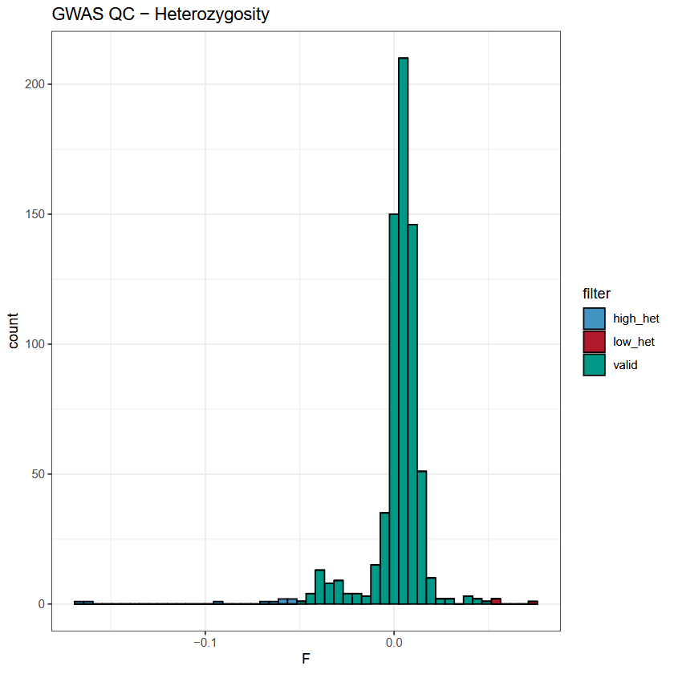

# Quality Control

In this pratical the quality control steps will be shared between the common single variants (GWAS) and rare variants (RVAS) association studies. The main steps are:
 1. Remove individuals based on missing data
 2. Remove variants based on Hardy-Weinberg
 3. Remove individuals with extreme heterozygosity
 4. Remove related individuals
 5. Compute the genomic PCA

## The data:

The data for this practical is available under `./data/` and contains:
 - *gwas.{bim,bed,fam}*: genotyping data in the [plink](https://www.cog-genomics.org/plink/1.9/) format
 - *gwas.covars*: a file of covariates
 - *regions.bed*: a file listing regions to analyse

### The plink format:

To perform a GWAS we need the phenotype of each individual and their genotype at each marker. To perform the quality control steps, we will use the [PLINK](https://www.cog-genomics.org/plink/1.9/) software, which read the required information from coupled .bim / .bed and .fam files.

 - The [.bim](https://www.cog-genomics.org/plink/1.9/formats#bim) file lists all the genotyped variants (position and alleles):
  
    | chromosome | identifier | position\_morgans | position\_bp | allele\_1 | allele\_2 |
    | --- | --- | --- | --- | --- | --- |
    | 1 | rs7519837 | 0 | 1596068 | C | T |
    | 1 | rs3737628 | 0 | 1755094 | T | C |
    | 1 | rs7511905 | 0 | 1825948 | A | C |
    | 1 | rs3855951 | 0 | 1836464 | C | T |
    | 1 | rs6603803 | 0 | 1844850 | G | A |

> [!NOTE]  
> The actual file does **not** have a header file.

 - The [.fam](https://www.cog-genomics.org/plink/1.9/formats#fam) file contains sample information:

    | FID | IID | paternal\_ID | maternal\_ID | sex | phenotype |
    | --- | --- | --- | --- | --- | --- |
    | CH18524 | NA18524 | 0 | 0 | 1 | 1 |
    | CH18526 | NA18526 | 0 | 0 | 2 | 1 |
    | CH18529 | NA18529 | 0 | 0 | 2 | 1 |
    | CH18532 | NA18532 | 0 | 0 | 2 | 1 |
    | CH18537 | NA18537 | 0 | 0 | 2 | 2 |

 - The [.bed](https://www.cog-genomics.org/plink/1.9/formats#bed) file represents the genotype calls. Must be accompanied by a .bim and .fam file.

> [!NOTE]  
> More information about the formats can be found in the [PLINK documentation](https://www.cog-genomics.org/plink/1.9/formats).

**Questions**: 

**Q1.1:** Have a look in chr15.bim. At which genomic position is located SNP rs4932079 ? What are two the observed alleles for this SNP is this dataset ?

<details>
    <summary> Answer </summary> 

> rs7111951 is located on chr11 at position 19973135 and the two observed alleles are *G* and *A*.

</details>

**Q1.2:** Have a look in gwas.fam. Which gender is individual NA18550 ?

<details>
    <summary> Answer </summary> 
    
> NA18547 is a female (5th column = 2)

</details>

## Our first steps with plink:

PLINK is a command-line standalone software dedicated to GWAS analyses. You will call this software with the alias `plink`. Try to print the help menu with the following command-line:

```shell
plink --help
```

For each of its function, PLINK will print a summary of data and actions in the console. We can ask information about missing data in our files using the `--missing` argument. Do not forget to indicate your input dataset using `--bfile` and an output name with `--out`:

```shell
plink --bfile gwas --missing --out gwas_missing
```

**Q1.3:** How many individuals contains this dataset ? How many males/females ? How many variants ?

<details>
    <summary> Answer </summary> 
    
> The dataset contains 90 people (45 males, 45 females) and 261,184 variants. 

</details>

## Remove individuals based on missing data:

The robustness of any result obtained with a GWAS depends heavily on the quality of the input data. This is why it is necessary to assess and filter the input data before doing any association tests. Usually individuals and variants with >5% missing data are removed from the dataset. This threshold can be adapted to your dataset (higher to keep more individuals, lower to be stricter). In PLINK, this can be done using the `--geno` and `--mind` options to filter variants and individuals respectively. For example to remove variants with >5% missing data, we can write:

```shell
plink --bfile gwas --geno 0.05 --make-bed --out gwas_filtered
```

**Q1.4:** Write the command to filter invididuals with more than 5% missing data.

<details>
    <summary> Answer </summary> 

    ```
    plink --bfile gwas_filtered --mind 0.05 --make-bed --out gwas_filtered
    ```

</details>

 **Q1.5:** How many individuals and variants are left after filtering ?

<details>
    <summary> Answer </summary> 

> 258,118 variants and 89 people are left.

</details>

Missing data can arise due to different factors, including poor quality libraries, errors during genotyping etc...

> [!TIP]
> You can manually remove individuals and variants with the `--extract` and `--exclude` options. This can be useful if some individuals removed consent to participate in the study or if some exclusions criterias are met.

## Remove variants based on Hardy-Weinberg

The `--hwe <p-value>` option in PLINK filters out all variants which have Hardy-Weinberg equilibrium exact test p-value below the provided threshold. This can be used to filter out genotyping errors, which can result in false positive hits. An extreme p-value (ef: 1e-50) can be used to avoid filtering out actual variants:

```shell
plink1.9 --bfile gwas_filtered --hwe 1e-50 --make-bed --out gwas_filtered
```

 **Q1.6:** How many variants are removed ? What happens if you set the p-value to 0.05 ? What are the consequences of choosing one value or the other ?

<details>
    <summary> Answer </summary> 

> 0 variants are removed with 1e-50. When using 0.05, ~8000 variants are removed, but you are at risk of removing variants which are not resulting from genotyping errors and are associated with the trait.

</details>

 **Q1.7:** PLINK only performs this tests on controls (based on information from the .fam file), why ?

 <details>
    <summary> Answer </summary> 
    
> In cases, we can expect some variants to be not constrainted by natural selection, which is one of the assumptions of the HWE equation.

</details>

## Remove individuals with extreme heterozygosity

Individuals with extreme heterozygosity levels are usually removed from GWAS analyses, to avoid biases due to consanguinity (low het. levels) and library preparation (high het. levels.). We will use the F coefficient, which reports the observed and expected autosomal homozygous genotype counts for each sample.

> [!Note]
> The F coefficient is inversely correlated with heterozygosity (the lower the heterozygosity, the larger the F value).

We need to generate a file with the F coefficients using PLINK. This can be done using the `--het` option, but it does not take Linkage Disequilibrium (LD) into account, so we will generated a list of independant variants first:

```shell
plink --bfile gwas_filtered --indep-pairwise 200 50 0.25 --out gwas_filtered
```

This will generate a list of pruned variants, using a window size of 200 variants, moving 50 variants at a time, removing pairs of variants with a LD r2 > 0.25. Now, we can use this list of independant variants to compute the F coefficients:

**Q1.8:** Write the command to compute the F coefficient on the *gwas_filtered* dataset, using only the SNPs present in *gwas_filtered.pruned.in*.

 <details>
    <summary> Answer </summary>

```
plink --bfile gwas_filtered --extract gwas_filtered.pruned.in --het --out gwas_filtered
```

 </details>

In this practical, we will remove samples outside 3 standard deviations for the cohort's mean. The [het_check.R](scripts/het_check.R) script can be used for this purpose ("both" means that both individuals with a F coeff >= 3 SDs and <= 3 SDs will be removed):

```shell
Rscript scripts/het_check.R -i gwas_filtered.het -f "both"
```

The script also plots the distribution of the F coefficients in the cohort. A low F value corresponds to a high heterozygosity and a high F value corresponds to a low heterozygosity and are plotted in red and blue respectively.



> [!WARNING]
> If you have admixed samples in your cohort, they will have a very low F coefficient and you should consider wether or not to remove them from the analysis, as the high heterozygosity is then expected and is not reflective of the quality of the library.

We can then produce the final filtered file by only keeping the individuals which are passing the heterozygosity filter:

```shell
plink --bfile gwas_filtered --keep gwas_filtered.valides --make-bed --out gwas_filtered
```

## Remove related individuals

One of the assumptions in a GWAS is that the observations (individuals) are independant. If two individuals are from the same family, they share the same genetics but also a similar environment, which can lead to spurious associations. If family information is not present, we can use the IBD (Identity By Descent) to estimate the relatedness between pairs of individuals.

## Compute the genomic PCA
