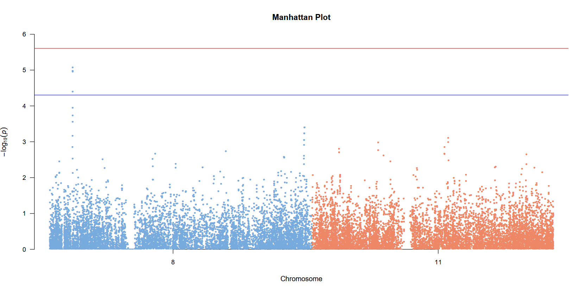
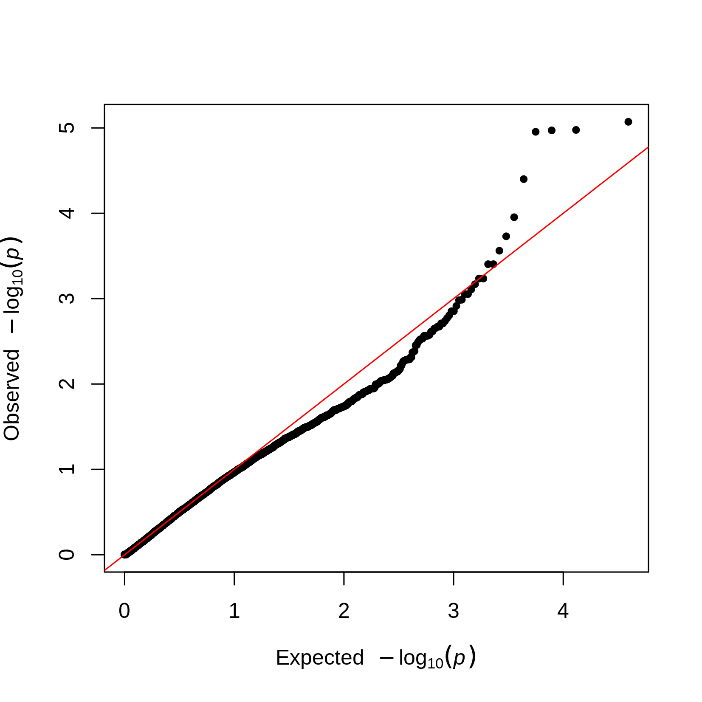

# GWAS (Genome Wide Association Study)

Now that we have applied quality control to our dataset, we can proceed with the association tests. We will perform one association test per variant present in our dataset. The objective is to assess which variants significantly impact the probability to harbor the trait under study.

## Filtering on chromosomes:

For the purpose of this practical, we are going to focus on chromosomes 8 and 11. We can use the `--chr` parameter in PLINK to only keep variants belonging to a specific chromosome:

```shell
plink --bfile QC/gwas_final --chr 8,11 --make-bed --out QC/gwas_final_subset
```

## A simple GWAS model:

In a GWAS, each locus is studied independently, by modelling the relation between the phenotype *Y* and the SNP:

```math
Y = f(\alpha X + \beta SNP) + \epsilon
```

Where:
 - *Y* is the phenotype (e.g., 0 or 1 when performing with a "cases vs controls" study)
 - *X* is a covariate matrix (e.g., age, sex, smoking status)
 - *SNP* represents the alleles of the variant (coded 0,1,2 in an additive model)
 - *α* and *β* are the parameters of the model to estimate

The function *f* depends on the phenotype *Y* under study:
 - For **continuous** Y: we will use a **linear** regression
 - For **categorical** Y: we will use a **logistic** regression

> [!Note]
> Other models are possible, for example a model that takes into account a dominant or recessive gene action.

In a GWAS our null hypothesis (H0) is: `The genetic variant is not associated with the trait`. This translates in our model as *β = 0*.

Here, we have a case/control phenotype, so we are going to perform a logistic regression on our data. Use the following PLINK command:

```shell
mkdir GWAS/

plink --bfile QC/gwas_final_subset --logistic --out GWAS/gwas_logistic
``` 

This should generate a `gwas_logistic.assoc.logistic` file, containing the results of our regression model. The documentation for this file is available here: https://www.cog-genomics.org/plink/1.9/formats#assoc

**Q2.1:** In the "TEST" column, what does "ADD" mean ? (hint: look at the [documentation](https://www.cog-genomics.org/plink/1.9/assoc#linear) about the linear/logistic model)

<details>
    <summary> Answer </summary> 

> 'ADD' means that our model considers an 'additive' effect of the SNP. In other words, we assume that the allelic dosage is additive: homozygous variants have twice the effect of heterozygous variants on the phenotype. The variants are coded 0/1/2 for homozygous reference / heterozygous / homozygous alternative. The additive model is the most common in GWAS due to its simplicity and power to detect associations under a wide range of genetic architectures.

</details>

Next, we will explore our results using `R`:

```R
gwas_results <- read.table("GWAS/gwas_logistic.assoc.logistic", header = TRUE)
gwas_results <- gwas_results[order(gwas_results$P),] # Ordering the results by P-values
```

**Q2.2**: Before looking at the results, how reliable do you think our model is? (hint: go back to the QC part and check if anything could bias our results, or lead to false positive hits). Is there anything missing in our formula?

<details>
    <summary> Answer </summary> 

> During the quality control steps, we noticed that we had two distinct groups in the genetic PCA, with an imbalance in their phenotype distribution. This will likely lead to false positive associations in our GWAS: e.g., SNPs that are related to the population groups and not directly to our phenotype of interest. To solve this, we can add the components from the PCA as covariates in our model to account for population structure.

</details>

**Q2.3**: Have a look at the first lines of the data.frame, what are the most associated SNPs? To confirm our hypothesis from the previous questions, look at the first SNPs in [gnomAD](https://gnomad.broadinstitute.org/) (1KG tab).

<details>
    <summary> Answer </summary> 

> - Our top hit, rs2513514 has an AF of 0.48 in Japanese but only 0.31 in Han Chinese. 
> - The 2nd hit rs2508756 has an AF of 0.50 in Japanese but only 0.33 in Han Chinese. 
> - The 3rd hit rs7840927 has an AF of 0.81 in Japanese and 0.85 in Han Chinese.
> - These differences suggest that the top hits may be tagging population structure rather than true causal variants. Could some of our results be biased by ancestry?

</details>

## The adjusted model:

Luckily, we have a file in our dataset indicating which population each sample belongs to: `./data/gwas.covars`. This is often not the case, and instead we could use the principal components of the genetic PCA we computed earlier `pca.eigenvec` as covariates in our model to account for population structure.

Build the model including population as a covariate:

```shell
plink --bfile QC/gwas_final_subset --logistic --covar data/gwas.covars --covar-name POP --out GWAS/gwas_logistic_adjusted
```

> [!WARNING]
> It is very important to include relevant covariates in your GWAS analysis. Not doing so could result in apparently significant but spurious associations.

As before, a `gwas_logistic_adjusted.assoc.logistic` file is generated, containing the output from our model.

**Q2.4**: Look at the first lines of the file, what is the main difference with the previous one?

<details>
    <summary> Answer </summary> 

> We now have lines with a "POP" value for the "TEST" column. This corresponds to the p-value of the covariate against the phenotype.

</details>

Now that we have working model, we can check our top results:

```R
adj_gwas_results <- read.table("GWAS/gwas_logistic_adjusted.assoc.logistic", header = TRUE)
adj_gwas_results <- adj_gwas_results[adj_gwas_results$TEST == "ADD",] # Only keeping the SNP p-values
adj_gwas_results <- adj_gwas_results[order(adj_gwas_results$P),] # Ordering the results by P-values
```

**Q2.5**: Check the top three SNPs from the initial model: rs2513514, rs7840927 and rs2508756. What are their p-values in the adjusted model? How do the differences in p-values compare to the differences in allele frequencies?

<details>
    <summary> Answer </summary>

> - rs2513514 7.76e-04 vs 6.29e-06
> - rs2508756 1.02e-03 vs 1.67e-05
> - rs7840927 1.06e-05 vs 5.49e-05
> 
> Their p-values dropped dramatically after adjustment, suggesting their initial significance was largely driven by population structure.

</details>

**Q2.6**: Check the top SNPs from the new model in gnomAD.

<details>
    <summary> Answer </summary> 

> - rs554297 has an AF of 0.96 in Japanese, 0.98 in Han Chinese
> - rs7840927 has an AF of 0.81 in Japanese, 0.89 in Han Chinese
> - rs11204005 has an AF of 0.59 in Japanese, 0.58 in Han Chinese
>
> These SNPs are less likely to be influenced by population structure and could be true positive hits!

</details>

Now, we can make the Manhattan and Quantile-Quantile plots. We filter for "ADD" tests to exclude covariate p-values from the plot:

```shell
head -n 1 GWAS/gwas_logistic_adjusted.assoc.logistic > GWAS/gwas_adjusted_SNPs.assoc.logistic # We keep the header line
awk '$5 == "ADD" { print }' GWAS/gwas_logistic_adjusted.assoc.logistic >> GWAS/gwas_adjusted_SNPs.assoc.logistic # We only keep the lines corresponding to "ADD"
```

## Manhattan Plots:

```shell
Rscript ./scripts/manhattan_plot.R -i GWAS/gwas_logistic.assoc.logistic -b BP -m SNP -p P -o GWAS/manhattan.pdf -v TRUE
Rscript ./scripts/manhattan_plot.R -i GWAS/gwas_adjusted_SNPs.assoc.logistic -b BP -m SNP -p P -o GWAS/manhattan_adjusted.pdf -v TRUE
```



## QQplots:

A Quantile-Quantile plot (QQplot) is a graphical tool used in GWAS to assess the distribution of observed p-values against the expected distribution under the null hypothesis (no association between the variant and the trait):
 - The x-axis represents the expected -log10(p-values) under the null hypothesis (uniform distribution).
 - The y-axis represents the observed -log10(p-values) from the association test.

```shell
Rscript ./scripts/QQplot.R -i GWAS/gwas_logistic.assoc.logistic -p P -o GWAS/QQplot.png -v TRUE
Rscript ./scripts/QQplot.R -i GWAS/gwas_adjusted_SNPs.assoc.logistic -p P -o GWAS/QQplot_adjusted.png -v TRUE
```




How to interpret:
 - If the points lie on the diagonal line (y=x), the observed p-values follow the expected distribution, indicating no systematic bias or inflation.
 - Deviation above the line suggests potential associations (true signals) or population stratification/inflation.
 - Deviation below the line may indicate conservative test statistics or overcorrection.

QQplots are essential for diagnosing genomic inflation and identifying potential false positives or technical artifacts in GWAS results. Here, we can see that the non-adjusted model presents a slight inflation due to population stratification. In the adjusted model, we lack power to detect associations and will need more samples to validate the peak we observed.

## Post-GWAS steps:

Great! We now have regions significantly associated with our trait. However, we can never be certain that our results are not due to some biases in our cohort / study. After a GWAS it is common to:
 - Validate the results using an independent cohort: with less individuals, but testing only the significant regions. Since we are doing less tests, we do not need to correct as much. If our locus is still significant, it is robust evidence of the association between our locus and the trait.
 - Create a regional plot: plotting a zoomed version of our significant locus. We can check the LD pattern between the SNPs in that region and look at the neighboring genes.
 - Experimentally confirm the effect of the gene on our trait (with CRISPR knockouts for example).

> [!WARNING]
> Association studies can find **associations** between alleles and a trait. However, the **causal** link between each allele and the trait cannot be inferred directly. The causal SNP might be a SNP in LD with the significant allele, or there might be an indirect effect of the allele on the trait, involving other genes.

## Pitfalls and other caveats:

### The "missing heritability":

Traits, especially complex ones, are influenced by many factors, including genetics but also environmental. GWAS only captures the genetic part of the trait heritability.

Moreover, GWAS, by design, can only capture common SNPs. But genetic components of traits are also due to rare, but more impactful SNPs, and larger events: Structural Variants (SVs), and Copy Number Variations (CNVs).

### The "additive" model:

The GWAS model assumes a simplistic additive effect of variants. But we know that:
 1. Some variants have dominant/recessive associations with the trait
 2. Some variants have pleiotropic effects (they affect multiple traits at once)
 3. There can be an epistatic effect of different genes (G) for the same trait (G*G interaction)
 4. Some SNPs (G) have an effect only when some environmental (E) factors are in play (G*E)

Some of these issues are easily solved (you can code the SNPs as 0/1 to make a dominant SNP model), others less so.

In the [next section](../3_RVAS/), we will perform Rare Variants Association Studies and try to solve some of the "missing heritability" problem.
