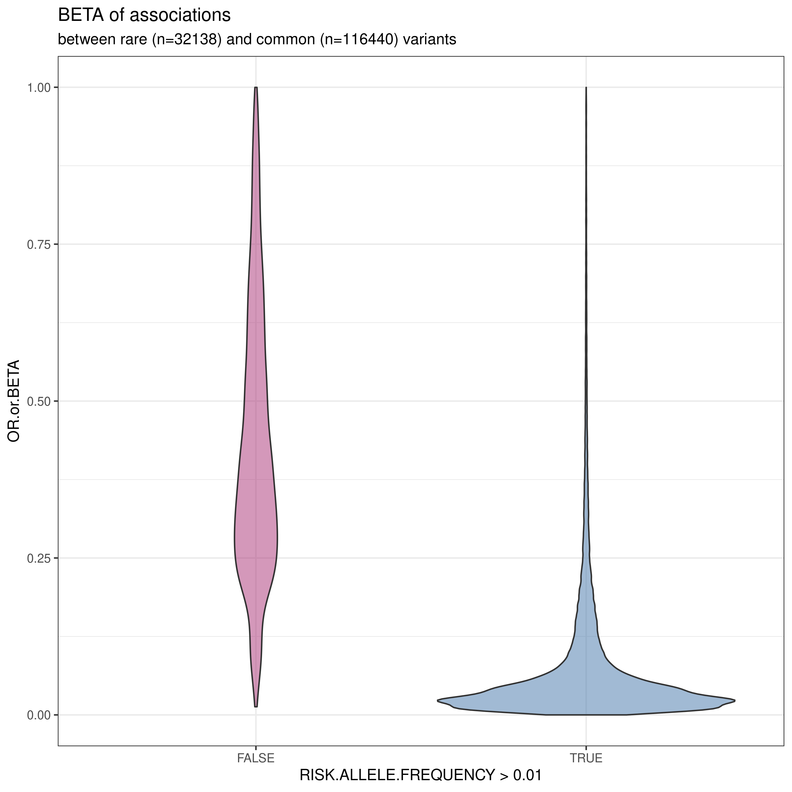

# RVAS (Rare Variants Association Studies)

 1. [Introduction](#introduction)
 2. [Methods](#methods)
 3. [SAIGE](#saige)
 4. [Preparation of the input data](#preparation-of-the-input-data)
 5. [Creating the null model](#step-1-creating-the-null-model)
 6. [Creating the full model](#step-2-creating-the-full-model)

## Introduction

In the last section, we found variants associated with our trait of interest. However GWAS, by design, can only find "common" SNPs in our population, as it needs enough carriers of each allele to reach statistical significance. We know that rare variants can have a high impact on diseases. For example, a **Mendelian trait** is a trait influenced by a single gene. A known example of Mendelian disease is Huntington disease, often caused by an inherited mutation in the *HTT* gene.

The plot below represents the distribution of beta values between rare (MAF < 0.01) and common (MAF > 0.01) variants in the [GWAS catalog associations file](https://ftp.ebi.ac.uk/pub/databases/gwas/releases/latest/) (as of November 2026). 



**Q3.1**: Interpret the plot. What does this suggest about the effect sizes of rare vs. common variants?

<details>
    <summary> Answer </summary>

> We can see that there is a overrepresentation of low beta values in the common variants compared to the rare variants. This suggests that common variants tend to have smaller effect sizes, while rare variants can have larger effects, as expected for Mendelian traits.

</details>

> [!NOTE] 
> The definition of a rare variant differs between studies. Most of the time, variants with a Minor Allele Frequency (MAF) < 0.01 are considered rare.

**Q3.2**: Look at the Minor Allele Frequencies (MAF) of the top associated SNPs in our GWAS analysis, are there any rare variants? (Here, we will consider a MAF < 0.01).

```shell
plink --bfile QC/gwas_final --freq --out RVAS/gwas_final
```

<details>
    <summary> Answer </summary>

> There are none. Remember that we removed rare SNPs during the last step of the quality control pipeline, to reduce the multiple testing burden in GWAS. And even if we kept them, it is unlikely that they would reach statistical significance in a standard GWAS analysis. However, this also removed potentially high-impact rare variants, which is why we now use aggregation methods.

</details>

Studying rare variants complements standard GWAS analyses by uncovering mechanisms and high-impact genotype-phenotype associations that common variant analyses may miss. But how can we study rare variants, which have low frequencies and are more numerous than common variants?

## Methods

The main rationale is to aggregate the rare variants by regions, often genes, to aggregate their effects. Multiple tools have been developed to perform this task, with different approaches.


### The Burden model:

In a Burden test, the genetic variants in a defined region are aggregated into a single "burden" score. The score is often obtained with a weighted sum of the rare alleles carried by an individual. The weights are often based on the MAF or functional annotation.

For a region with *n* variants, the Burden score *B* for the individual *i* is obtained with:

```math
{B}_{i} = \sum_{j=1}^{n} {w}_{j}{G}_{ij}
```

Where: 
 - `wj` is the weight of variant j
 - `Gij` is the genotype of the individual *i* for variant *j* (0,1,2)

The association test itself is a regression of the phenotype on the burden score:

```math
 {y}_{i} = \alpha + \beta {B}_{i} + \epsilon_{i}
```

Where *β* represents the effect of the burden score on the phenotype:
 - β = 0 means that the rare variants in the region do not collectively contribute to the trait being studied (H0)
 - β =/= 0 it suggests that the burden of rare variants in the region is associated with the phenotype (H1)

Typically, a Wald test, score test, or likelihood ratio test is used to assess the significance of β. Please note that burden tests lose power if causal variants have opposite effects (e.g., some risk, some protective).

**Q3.3**: Why might a Burden test lose power if some rare variants in the region are protective and others are risk-increasing?

<details>
    <summary> Answer </summary>

> Burden tests collapse all variants into a single score, assuming they all contribute to the trait in the same direction. If some variants are protective (negative effect) and others are risk-increasing (positive effect), their effects cancel out in the aggregated score, reducing the test’s power to detect an association.

</details>

### The Variance-Component model:

The Sequence Kernel Association Test (SKAT) is a **variance-component** test that tests the variance of genetic effects rather than the mean. It is more flexible than a Burden test since it allows for both protective and risk variants in the same region. SKAT models the variant effect as random effect and tests whether the variance of these effects is greater than zero.

For a region with *n* variants, SKAT assumes that:

```math
{y}_{i} = \alpha + \sum_{j=1}^{n} {G}_{ij} \beta_{ij} + \epsilon_{i}
```

Where:

```math
\beta_{j} = N(0, \tau w^2_{j})
```
 - `w²j` the weight of variant *j*
 - `τ` the region unknown variance

Under the null hypothesis (H0) of non-association between the region and the trait, `βj=0 for all j` is equivalent to `τ=0`. Thus, the model tests if:
 - τ = 0, no association (H0)
 - τ > 0, we reject the "no association" hypothesis (H1)

SKAT is robust to the presence of non-causal variants and can detect associations even if only a subset of variants in the region are causal.

### The Combined model:

SKAT-O (Sequence Kernel Association Test, Optimal) is a weighted linear combination of both Burden and SKAT test statistics, designed to maximize power across a range of genetic architectures:

```math
Q_{SKAT-O} = \rho \cdot Q_{Burden} + (1-\rho) \cdot Q_{SKAT}, \quad 0 \leq \rho \leq 1
```

Where: 
 - `Q_Burden`: Burden test statistic
 - `Q_SKAT`: SKAT test statistic
 - `ρ`: Weight estimated from the data to optimise power

A high `ρ` value gives more weight to the Burden test statistic while a low `ρ` value gives more weight to the SKAT test statistic. When `ρ=0` SKAT-O behaves like a Burden test and when `ρ=1` it behaves like a SKAT test. The value of `ρ` is determined from the data, by performing the ratio of the fixed effect variance (Burden) and the random effect variance (SKAT).

The test statistic is then computed as the weighted sum of the Burden and SKAT statistics using this estimated `ρ`.

### Summary:

| Approach | Rationale | Advantage | Disadvantage | Tools |
| --- | --- | --- | --- | --- |
| Burden Test | Collapse rare variants in a genetic region | Powerful if all variants in the region are causal and in the same direction | Less powerful if only a few variants are causal, or have an opposite effect | CAST; WST |
| Variance-component test | Test the variance of genetic effects | Allows for SNP-SNP interaction; Powerful when non-causal variants are present (or protective and deleterious variants) | Less powerful than Burden when all variants are causal and in the same direction | Sequence kernel association test (SKAT) |
| Combined tests | Combines Burden and Variance-component tests | Powerful even with few causal variants, having opposite directions | Needs accurate classification of the variants impact; Choosing an appropriate kernel is often challenging | SKAT-O; MiST |

## SAIGE (Scalable and Accurate Implementation of Generalized Mixed Effects Models)

In this practical, we are going to use [SAIGE-GENE+](https://github.com/saigegit/SAIGE) a scalable and efficient tool for rare variant association testing in large biobanks (e.g., UK Biobank, All of Us).

SAIGE-GENE+:
- Handles **large datasets** (millions of samples).
- Supports **burden, SKAT, and SKAT-O** tests.
- Includes **covariate adjustment** (e.g., PCs, sex, age).
- Optimized for **binary and quantitative traits**.
- Works with **VCF/BCF files** (or PLINK formats).

## Preparation of the input data:

SAIGE-GENE+ requires:
 - Genotype data in the plink format: *.bed / .bim / .fam*

 - Phenotype data, which can contains covariates:

| IID | FID | PHENOTYPE | POP | PC1 | PC2 |
| --- | --- | --- | --- | --- | --- |
| CH18524 | NA18524 | 0 | 1 | 0.118372 | 0.0180349 |
| CH18526 | NA18526 | 0 | 1 | 0.103803 | \-0.000732849 |
| CH18529 | NA18529 | 0 | 1 | 0.100738 | 0.00759697 |

> [!NOTE]  
> For binary phenotypes the phenotypes are coded with 0 (controls) and 1 (cases).
 
 - A .groupFile, which indicates which variants belong to a region and their annotations:

```
NAT2 var rs2029830
NAT2 anno MODIFIER
GFRA2 var  rs117857 rs156430 rs1706057
GFRA2 anno no_annot MODERATE no_annot
```

## Step 1: creating the null model:

First, we are going to create the null model, which represents the impact of the covariates **only** on the trait (here the population structure: "POP"). This null model will be used in step 2 for adjusting the full model.

```shell
Rscript /opt/progrs/SAIGE/extdata/step1_fitNULLGLMM.R \
    --plinkFile="QC/gwas_filtered" \
    --phenoFile="../data/saige.phenofile" \
    --phenoCol="PHENOTYPE" \
    --covarColList="POP" \
    --qCovarColList="POP" \
    --sampleIDColinphenoFile="IID" \
    --isCovariateOffset=FALSE \
    --invNormalize=FALSE \
    --isCateVarianceRatio=TRUE \
    --traitType=binary \
    --outputPrefix=saige_out \
    --nThreads=2 \
    --IsOverwriteVarianceRatioFile=TRUE
```

This step creates to files, that will be used in step 2:
 1) *saige_out.rda*: containing the null model
 2) *saige_out.varianceRatio.txt*: a variance-ratio file

### The variance-ratio:

The variance-ratio (often denoted as tau) is the ratio of:
 - The variance of the random effects (due population structure, polygenic brackground etc...)
 - The variance of the residual error (unexplained variance in the phenotype)

If `tau=0`: there is no random effect variance (no population structure);
If `tau>0`: there is additional variance due to unmodeled factors (e.g., population stratification, familial relatedness).

SAIGE will use this ratio to adjust the test statistics to account for inflation caused by these confounders.

## Step 2: creating the full model:

This step performs burden, SKAT, and SKAT-O tests using the null model from Step 1.

```shell
Rscript /opt/progrs/SAIGE/extdata/step2_SPAtests.R \
        --bedFile="QC/gwas_filtered.bed" \
        --bimFile="QC/gwas_filtered.bim" \
        --famFile="QC/gwas_filtered.fam" \
        --AlleleOrder="alt-first" \
        --groupFile="../data/saige.groupFile" \
        --GMMATmodelFile="RVAS/saige_out.rda" \
        --varianceRatioFile="RVAS/saige_out.varianceRatio.txt" \
        --LOCO=FALSE \
        --is_output_markerList_in_groupTest=TRUE \
        --is_single_in_groupTest=FALSE \
        --SAIGEOutputFile="./RVAS/saige_gene_based.tsv" \
        --maxMAF_in_groupTest=0.001,0.01,0.1 \
        --annotation_in_groupTest="no_annot:HIGH:MODIFIER:MODERATE:LOW"
```

The output file `RVAS/saige_gene_based.tsv` should contain the following data:
 - *Region*: set name
 - *Group*: the annotation mask considered (variants without these annotaitons were ignored)
 - *max_MAF*: the MAF mask considered (variants with `MAF > max_MAF` were ignored)
 - *Pvalue*: the p-value of the SKAT-O test
 - *Pvalue_Burden*: the p-value of the burden test
 - *Pvalue_SKAT*: the p-value of the SKAT test
 - *BETA_Burden*: the effect-size estimated by the burden test
 - *SE_Burden*: the standard error of the effect-size
 - *MAC*: Minor Allele Count in the set
 - *MAC_case*: Minor Allele Count in cases
 - *MAC_control*: Minor Allele Count in controls
 - *Number_rare*: number of markers that are not `MAC > MACCutoff_to_CollapseUltraRare` (=10 by default)
 - *Number_ultra_rare*: number of markers that are `MAC <= MACCutoff_to_CollapseUltraRare` (=10 by default)

As for the gwas results, we have a `p-value` indicating the strength of association between the set and the phenotype and a `BETA` value indicating the effect-size.

**Q3.4**: What is the top gene in terms of p-value? What is the beta value of this gene and what can you conclude?

<details>
    <summary> Answer </summary> 

> The top gene is SCARA5. The Beta value is 1.78, which means that cases are enriched in rare variants in this gene.

</details>


## QQPlot:

As for the GWAS analysis, we can create a QQplot to check inflation/deflation of the p-values we obtained with the set-tests:

```shell
Rscript ./scripts/QQplot.R -i RVAS/saige_gene_based.tsv -p Pvalue -o RVAS/QQplot_SKATO.png -v TRUE
Rscript ./scripts/QQplot.R -i RVAS/saige_gene_based.tsv -p Pvalue_SKAT -o RVAS/QQplot_SKAT.png -v TRUE
Rscript ./scripts/QQplot.R -i RVAS/saige_gene_based.tsv -p Pvalue_Burden -o RVAS/QQplot_Burden.png -v TRUE
```

**Q3.5**: Interpret the QQplot.

## Going further

SAIGE gives the possibility to apply annotations masks. For each region, SAIGE will perform one test per mask (for example only markers annotated with a "HIGH" impact). This can uncover some more subtle associations between genes and phenotypes.

Check the SAIGE documentation and try to apply different annotation masks ("--annotation_in_groupTest").

## Materials:

 - https://github.com/saigegit/SAIGE

 - https://cloufield.github.io/GWASTutorial/34_rare_variant/#skat-sequence-kernel-association-test

 - https://joellembatchou.github.io/SISG2026_Association_Mapping/index.html